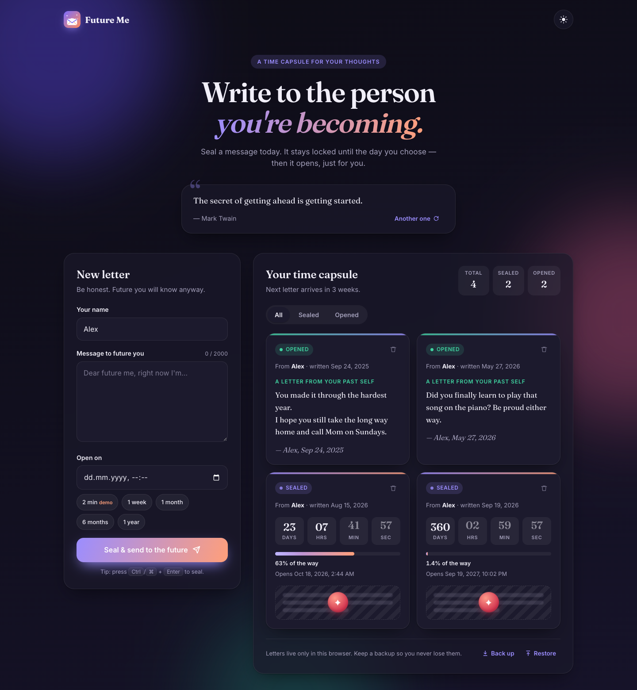
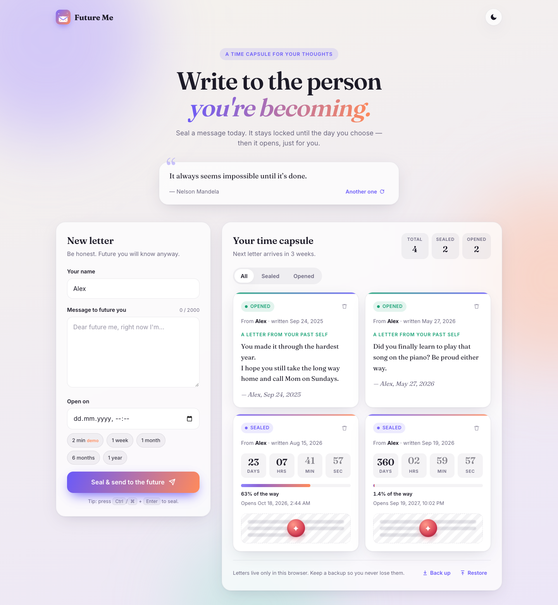
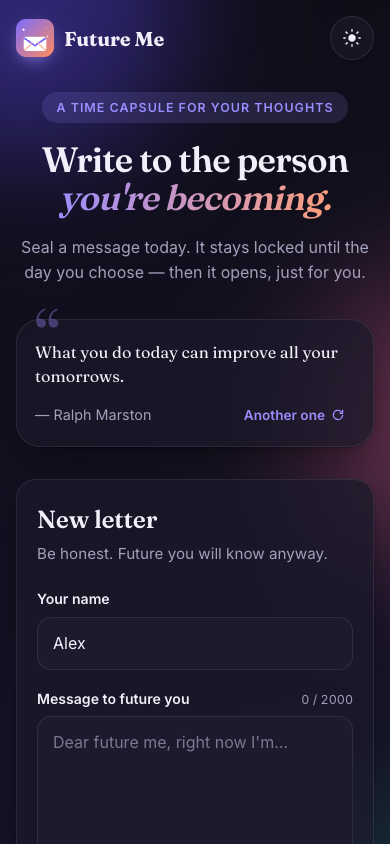
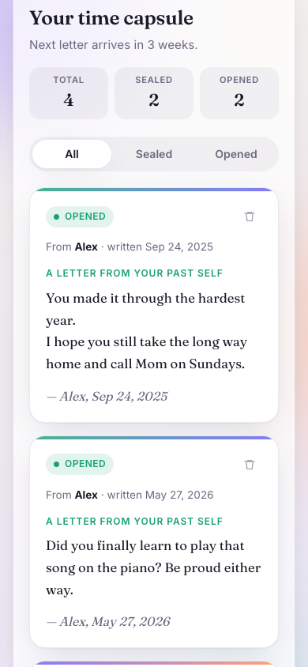

<div align="center">


# Future Me

**Write to the person you're becoming.**

Seal a letter to your future self today. It stays locked until the day you choose — then it opens, just for you.

[](https://utku-kucuk.github.io/FUTURE-ME/)
[](LICENSE)
[](script.js)


### [Open the live app →](https://utku-kucuk.github.io/FUTURE-ME/)

<br />



</div>

---

## ✨ Features

| | |
|---|---|
| 💌 **Write & seal** | Your name, a letter (up to 2,000 characters) and the exact date and time it should open. Quick presets for 1 week, 1 month, 6 months, 1 year — or a 2-minute demo. |
| ⏳ **Live countdown** | Every sealed letter ticks down in days, hours, minutes and seconds, with a progress bar showing how far along the wait you are. |
| 🎉 **Reveal animation** | When the moment arrives, the wax seal breaks, the letter unfolds and confetti bursts. Letters that arrived while you were away are revealed the next time you visit. |
| 🔒 **Sealed** | A sealed letter's text is never rendered into the page until its date, so there's no accidental peeking. |
| 🌗 **Dark / light mode** | Follows your system setting by default; your choice is remembered. |
| 💬 **Motivational quotes** | A rotating collection of quotes about time, growth and beginnings. |
| 💾 **Back up & restore** | Letters live in your browser's `localStorage`. Export them to a JSON file and restore them on any device. |
| 🔔 **Background alerts** | If a letter opens while the tab is in the background, the tab title lets you know — and the reveal waits for you. |
| 📱 **Responsive & installable** | Works beautifully from phones to wide screens, and can be installed as an app (web manifest + icons). |
| ♿ **Accessible** | Semantic HTML, keyboard friendly, screen-reader labels, and full `prefers-reduced-motion` support. |

## 📸 Screenshots

<table>
  <tr>
    <td width="50%"></td>
    <td width="50%"></td>
  </tr>
  <tr>
    <td align="center"><sub>Light mode</sub></td>
    <td align="center"><sub>Dark mode</sub></td>
  </tr>
</table>

<p align="center">
  
  &nbsp;&nbsp;
  
</p>

## 🚀 Getting started

No build step, no dependencies — just three files.

```bash
git clone https://github.com/utku-kucuk/FUTURE-ME.git
cd FUTURE-ME
```

Then pick one:

- **Double-click** `index.html` to open it in your browser, or
- **VS Code:** right-click `index.html` → *Open with Live Server*, or
- **Any static server:** `python3 -m http.server 8000` and visit <http://localhost:8000>.

> **Tip:** press the **2 min** preset to watch a letter unseal without waiting a week.

## 🌍 Deploying

Future Me is a fully static site and runs anywhere that serves files: GitHub Pages, Netlify, Vercel, Cloudflare Pages, or your own server. All paths are relative.

**GitHub Pages:** *Settings → Pages → Build and deployment → Deploy from a branch → `main` / root*. The included `.nojekyll` file skips Jekyll processing.

If you deploy to a different URL, update the `canonical`, `og:url` and `og:image` tags in `index.html`.

## 🗂 Project structure

```
FUTURE-ME/
├── index.html             # Markup, meta tags and the letter card template
├── style.css              # Theme tokens, layout, animations, responsive rules
├── script.js              # Storage, countdowns, reveal, quotes, theme, backups
├── manifest.webmanifest   # Installable web app metadata
├── assets/
│   ├── icon.svg           # Animated logo & favicon
│   ├── icon-192.png       # App icons
│   ├── icon-512.png
│   ├── icon-maskable-512.png
│   ├── apple-touch-icon.png
│   ├── og-image.png       # Social preview image
│   └── screenshots/       # README images
├── LICENSE
└── README.md
```

## ⚙️ How it works

Each letter is stored in `localStorage` under `futureMe.messages.v1`:

```json
{
  "id": "4f7c…",
  "name": "Alex",
  "text": "Dear future me…",
  "createdAt": 1790000000000,
  "unlockAt": 1821536000000,
  "seen": false
}
```

A single one-second clock updates every visible countdown in place (no re-rendering). When `Date.now()` passes `unlockAt`, the card plays its reveal and `seen` is set to `true` so the animation only happens once.

## 🔐 Privacy

Everything stays on your device. There is no server, no account, no analytics and no tracking — your letters never leave your browser unless you export a backup yourself.

Because letters are stored per browser, clearing your site data or switching browsers will hide them. Use **Back up** to keep a copy.

The seal is a commitment device, not encryption: letters are stored as plain text in `localStorage` and in backup files, so anyone with access to your browser or a backup can read them early.

## 🧭 Browser support

Latest versions of Chrome, Edge, Firefox and Safari (desktop and mobile).

## 🤝 Contributing

Ideas and pull requests are welcome! Open an issue to suggest a feature or report a bug.

1. Fork the repo
2. Create a branch: `git checkout -b feature/my-idea`
3. Commit your changes and open a pull request

## 📄 License

Released under the [MIT License](LICENSE). Made with care for whoever you'll be.
